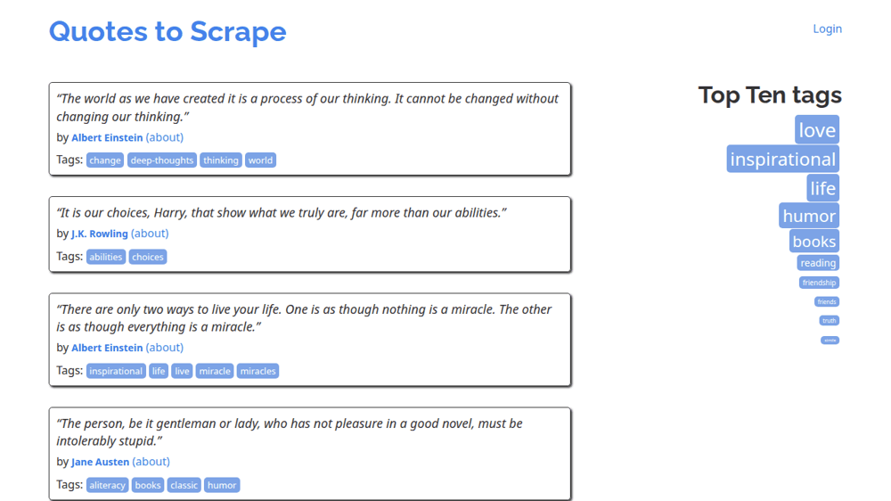

# polyfetch-scrape

> HTTP scraping toolkit: one typed `fetch()` over a reactive httpx → curl_cffi → Patchright fallback chain — TLS/JA3 impersonation, JS rendering, screenshots + interactive browser sessions, and a typed error taxonomy behind a single `Response`.

[](LICENSE)
[](CHANGELOG.md)
[](https://github.com/qte77/polyfetch-scrape/actions/workflows/test.yml)
[](https://github.com/qte77/polyfetch-scrape/actions/workflows/codeql.yaml)
[](https://www.codefactor.io/repository/github/qte77/polyfetch-scrape)
[](https://github.com/qte77/polyfetch-scrape/actions/workflows/test.yml)
[](https://github.com/qte77/polyfetch-scrape/actions/workflows/lint-md-links.yml)

## Why

Claude Code's built-in **WebFetch** exposes no header parameters, so callers cannot set `User-Agent`, `Accept`, or `Referer`. And headers alone often aren't enough: on a [2026-07-06 re-probe](docs/scraping-landscape.md#empirical-findings--polyfetch-scrape-probes-2026-04), `hamiltoncompany.com` returned `403` to `curl` even with a full browser UA, but `200` to polyfetch's tiers — the block keys on the client fingerprint, not the UA string. polyfetch is the next rung — browser-shape headers in the cheap tier, real TLS impersonation in the middle, headless Chromium with anti-detection patches as the fallback — escalating only when a tier is actually blocked.

## Quickstart

### Install

```bash
uv add git+https://github.com/qte77/polyfetch-scrape   # not published to PyPI
uv run patchright install chromium                     # one-off; only for the patchright tier
```

Or **borrow it without installing** — see [`USING.md`](USING.md). On Alpine/musl the browser tier can't run (no `musllinux` wheel); see [CLI-only commands](docs/api-reference.md#cli-only-commands).

### Library

```python
from polyfetch_scrape import fetch

r = fetch("https://example.com")
print(r.status, r.backend)  # e.g. 200 httpx — which tier answers depends on the target
```

## What

- **One call, typed result.** `fetch(url)` returns a typed `Response` whichever backend succeeded — no per-site tool picking.
- **Reactive three-tier fallback.** `httpx` → `curl_cffi` (Chrome TLS/JA3 impersonation) → Patchright (headless Chromium), escalating only on a real block; pin or bound it with `tier` / `min_tier` / `max_tier`.
- **Typed error taxonomy.** Terminal statuses (`401/404/407/410/451`) raise typed exceptions; `429` and `500/502/503/504` retry, honouring `Retry-After`.
- **Browser tier with DevTools capture.** Waits, screenshots, scripted actions, device/locale/colour-scheme emulation, video and HAR recording, headed launch, and console/network/JS-error capture — opt-in on `fetch`, always on in the interactive `render_session`.
- **Requests and politeness.** Conditional GET (`etag`/`last_modified`), `json`/`content` request bodies, a per-host `Throttle`, and an opt-in robots.txt check.
- **Structured-first discovery.** `discover(url)` reports sitemaps, RSS/Atom/iCal feeds, `llms.txt` and JSON-LD `@type`s, so consumers parse structured data instead of HTML.
- **Library, CLI, or env-borrow** from another repo or agent ([`USING.md`](USING.md)).

Full options: [API reference](docs/api-reference.md). Empirical anti-bot findings: [scraping landscape](docs/scraping-landscape.md).

<!-- markdownlint-disable MD033 -->
<details>
<summary>Screencast — polyfetch's <code>render_session</code> driving a headless browser through a live site: browse pagination → open the login form → fill and submit → land logged-in (one frame per step)</summary>

<picture>
  
</picture>

Regenerate with `make screencast` ([`examples/navigate_screencast.py`](examples/navigate_screencast.py)) — uses only the public `render_session` API.

</details>
<!-- markdownlint-enable MD033 -->

## Two layers: engine + scripting substrate

1. **The engine** — the stable, typed surface: `fetch`, `render_session` and `discover`. Most callers only need this.
2. **The scripting substrate** — `render_session(url).page` hands you the live, instrumented stealth-Patchright `Page` (full DevTools/CDP surface) for app-specific flows. polyfetch owns install, launch/teardown, capture and the SSRF guard; you own the app-specific steps.

Which side a knob belongs on is settled by the [ownership line](docs/architecture.md#two-layers-engine-and-scripts); worked `.page` recipes live in the [scripting cookbook](docs/scripting.md), and [`examples/`](examples/) shows the pattern (examples, not stable API).

## How

**I am a:** [Library user](#library) | [CLI user](#cli) | [Script author](#two-layers-engine--scripting-substrate) | [Agent / sideload](USING.md) | [Contributor](#development)

### CLI

```bash
polyfetch fetch https://example.com --json
polyfetch fetch https://quotes.toscrape.com/js/ --tier patchright --screenshot viewport --screenshot-out shot.png
polyfetch fetch https://example.com --max-tier curl_cffi   # cap escalation — never launch a browser
polyfetch bulk urls.txt --workers 4 --delay 0.5            # ≥0.5 s between same-host requests
polyfetch discover https://example.com --json              # sitemaps / feeds / llms.txt / JSON-LD
polyfetch doctor --fix                                     # verify (and install) the browser-tier Chromium
```

Every command and flag (request bodies, device emulation, video/HAR, `--headed`, …) and the `--json` schema: [`USING.md` → Commands](USING.md#commands).

### Fallback chain

| Tier | Backend | When it engages |
|---|---|---|
| 1 | `httpx` | every request first |
| 2 | `curl_cffi` (chrome impersonation) | tier 1 returns 403 or hits a TLS error |
| 3 | Patchright (headless Chromium) | tier 2 also blocked |

`Response.backend` says which tier answered. `make demo_tiers` shows what each tier uniquely provides; details in [architecture](docs/architecture.md#data-flow).

### Public API

`fetch`, `render_session`, `RenderOptions`, `RenderAction`, `Screenshot`, `Response`, `RetryPolicy`, `Throttle` and the `FetchError` hierarchy, plus `utils.discovery.discover` and `utils.robots.is_allowed` (imported by module path) — full signatures in the [API reference](docs/api-reference.md). `_backends/` is private; `contrib/` extras (e.g. `easter_hunt`) are unsupported and never imported by core.

### Development

`make setup_dev && make validate` (plus `make audit`). Full workflow, command reference and release pipeline: [`CONTRIBUTING.md`](CONTRIBUTING.md); agent rules: [`AGENTS.md`](AGENTS.md).

## How it compares

| Instead of… | polyfetch gives you |
|---|---|
| `httpx` / `requests` alone | the same simple call, plus automatic TLS impersonation and a browser fallback when a site blocks the plain client |
| `curl_cffi` / `cloudscraper` alone | TLS impersonation *and* a real headless browser behind one typed `Response` — no manual tier-picking |
| raw Playwright / Patchright | the browser install, launch/teardown, capture, retries and SSRF guard already wired; drop to `.page` only when you need to |
| a hosted scraping API | a dependency you run in-process: no per-request cost, no data leaving your machine, no vendor account |

Each row is a trade-off, not a claim of superiority. See the [scraping landscape](docs/scraping-landscape.md) for dated, empirical probes.

## What it does not do

- **Out of scope** (use a dedicated tool): proxy / residential-IP rotation, LLM-ready HTML→markdown extraction, a hosted scraping service, automated CAPTCHA solving, and domain API wrappers (arXiv, patents, …) — those belong in downstream packages that consume `fetch()`.
- **Not in the engine, but scriptable** on `render_session().page`: accessibility snapshots, multi-step walks, ad-hoc element screenshots, live viewport changes — see [Two layers](#two-layers-engine--scripting-substrate).

## References

- [Public API reference](docs/api-reference.md) — full signatures for `fetch`, `RenderOptions`, `Response`, `RetryPolicy`, and the exception hierarchy
- [Scripting cookbook](docs/scripting.md) — worked `render_session().page` recipes (DevTools capture, aria_snapshot, walks, live emulation)
- [Using without installing](USING.md) — call polyfetch from another repo/agent via `uv run --directory` (env-borrow contract: invocation, JSON schema, errors, stable surface)
- [Consuming across the estate](docs/estate.md) — the estate model, the ownership line, and the rule for when a consumer need becomes core
- [Architecture](docs/architecture.md) — fallback-chain data flow, component responsibilities, invariants
- [Roadmap](docs/roadmap.md) — delivery history + core directions ahead
- [User stories](docs/userstory.md) — who it serves and what each need maps to
- [Scraping landscape](docs/scraping-landscape.md) — tool comparison + empirical findings
- [web-recon-kit](https://github.com/qte77/web-recon-kit) — web/API recon harness; its browser tier builds on `render_session()` (optional git-dependency extra)
- [gha-rxiv-feed-action](https://github.com/qte77/gha-rxiv-feed-action) — fetch arXiv/bioRxiv/medRxiv feeds (open APIs; polyfetch's fallback chain isn't needed for these)
- [Changelog](CHANGELOG.md) — release notes (Keep a Changelog format)
- [Codespaces reference](https://github.com/qte77/polyforge-orchestrator/blob/main/docs/codespaces.md) — cross-qte77 Codespaces auth, signing and devcontainer setup

## License

Licensed under the [Apache-2.0](LICENSE) license (SPDX: `Apache-2.0`); see also [NOTICE](NOTICE).
